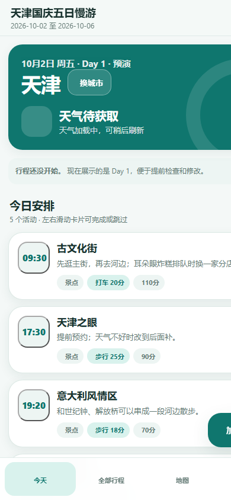

# 手机优先旅行行程 PWA

一个不需要构建工具的旅行行程 Web App。地图使用 Leaflet + OpenStreetMap，天气使用 Open-Meteo，地点搜索默认使用 Nominatim，并可选用高德 Web JS API，数据默认保存在浏览器 `localStorage`。

在线体验：[inspiring-capybara-8fb1d8.netlify.app](https://inspiring-capybara-8fb1d8.netlify.app/)



## 项目结构

```text
tianjin-trip-pwa/
├── index.html               # 页面与 CDN 依赖
├── styles.css              # 移动端优先样式与深色模式
├── app.js                  # 行程、地图、天气、云同步和交互逻辑
├── manifest.webmanifest    # PWA 清单
├── sw.js                   # Service Worker 离线缓存
├── vercel.json             # Vercel 静态部署配置
├── netlify.toml            # Netlify 静态部署配置
├── amap-config.example.js  # 高德配置示例（真实配置不提交）
├── docs/
│   └── screenshot-mobile.png
├── supabase/
│   └── schema.sql          # Supabase 示例表与开发用 RLS 策略
└── icons/
    ├── icon-192.png
    ├── icon-512.png
    └── apple-touch-icon.png
```

## 本地运行

Service Worker 不能通过 `file://` 正常工作，本地请启动静态服务器。

### 方式一：Python

```bash
cd tianjin-trip-pwa
python -m http.server 8080
```

打开：

```text
http://localhost:8080
```

### 方式二：Node

```bash
cd tianjin-trip-pwa
npx serve .
```

## 部署到 Vercel

1. 把整个 `tianjin-trip-pwa` 目录上传到 GitHub。
2. 在 Vercel 中导入仓库。
3. Framework Preset 选择 `Other`。
4. Build Command 留空。
5. Output Directory 填 `.`。
6. 部署完成后用 HTTPS 地址打开。

也可以安装 Vercel CLI 后直接运行：

```bash
cd tianjin-trip-pwa
npx vercel
```

## 部署到 Netlify

1. 把整个目录拖到 Netlify Drop，或连接 GitHub 仓库。
2. Build Command 留空。
3. Publish directory 填 `.`。
4. 部署后使用 Netlify 提供的 HTTPS 地址。

## 配置 Supabase 云同步

1. 在 Supabase 创建项目。
2. 打开 SQL Editor，执行 `supabase/schema.sql`。
3. 在 Supabase 项目设置中找到：

```text
Project URL
anon public key
```

4. 在 App 的「设置 → Supabase 云同步」中填写：

```text
Supabase URL
Anon Key
行程 ID，例如：tianjin-family-2026
行程共享密钥，例如：点击「生成密钥」得到的随机字符串
```

5. 打开「启用云同步」。
6. 先点「上传」，其他设备填写相同配置、行程 ID 和共享密钥后点「拉取」。

当前版本使用约 12 秒轮询进行同步，并采用较简单的“较新数据覆盖较旧数据”策略。`schema.sql` 使用行程共享密钥校验 RLS：只有提供匹配密钥的请求才能读写对应行，其他行不会被返回。共享密钥相当于行程的访问凭证，必须和同行成员私下分享，不能公开。

这是无需账号的“共享密钥”模型，不是个人账号权限模型：任何拿到行程 ID 和共享密钥的人都能编辑该行程。需要逐用户权限、审计和成员管理时，应改用 Supabase Auth，并在表中保存 `user_id` 或成员关系。

如果是从旧版开放策略升级，请先导出本地备份，再执行新版 SQL。旧云端行会被设置为不可猜测的新密钥，需要在 App 中配置新的共享密钥后重新上传。

`service_role` Key 拥有绕过 RLS 的管理权限，绝不能放进网页、GitHub 或 `localStorage`。

## 添加到手机主屏幕

### iPhone / Safari

1. 用 Safari 打开部署后的 HTTPS 地址。
2. 点击底部「分享」按钮。
3. 选择「添加到主屏幕」。
4. 确认名称后点击「添加」。

### Android / Chrome

1. 用 Chrome 打开 HTTPS 地址。
2. 点击右上角菜单。
3. 选择「安装应用」或「添加到主屏幕」。
4. 确认安装。

首次联网打开后，Service Worker 会缓存应用外壳。之后即使离线，也可以查看和编辑已经保存在本地的行程；地图底图、天气和地名搜索需要联网。

## 使用说明

- 「今天」：展示当天活动、天气和出行方式。活动卡片右滑标记完成，左滑标记跳过。
- 「全部行程」：按天折叠查看。桌面端支持拖拽排序，手机端长按拖拽把手排序；左滑删除，点击编辑。
- 「地图」：按天显示不同颜色的路线和编号标记。长按地图可以添加地点，底部按钮可以定位或显示全部天。
- 「设置」：修改日期、城市、主题、天气、Supabase、AI 简介和 OpenRouteService。
- 「+ 加一个地方」：快速添加时只填写地点名即可，其他信息可以后补。

## 免费 API

- 地图瓦片：OpenStreetMap
- 地图组件：Leaflet
- 天气：Open-Meteo
- 地点搜索：Nominatim

Nominatim 有公开使用频率限制，适合个人旅行使用。部署为公开服务时，应增加缓存或使用自有地理编码服务。

## 可选 AI 简介

在设置中填写兼容 OpenAI Chat Completions 的服务地址、模型和 API Key。默认值是：

```text
Base URL: https://api.deepseek.com
Model: deepseek-flash
```

API Key 建议仅在自己的设备上使用。Key 只保存在浏览器本地；云同步只上传行程数据，不上传 AI、高德、OpenRouteService 或 Supabase 密钥。

## 可选高德搜索

1. 复制 `amap-config.example.js` 为 `amap-config.js`。
2. 填入高德「Web端（JS API）」的 Key 和 securityJsCode。
3. 在高德控制台把部署域名加入白名单。
4. 不要把真实的 `amap-config.js` 提交到公开仓库。

高德返回 GCJ-02 坐标，应用会先转换为 WGS-84 再交给 Leaflet/OpenStreetMap 显示。

## 可选 OpenRouteService

未填写 Key 时，出行耗时使用经纬度直线距离和不同交通方式的粗略速度估算。填写 OpenRouteService Key 后，会尝试请求真实路线时长；请求失败时自动回退到直线估算。

## 数据备份

设置页支持导出和导入 JSON。建议旅行前导出一份备份，尤其是准备重装浏览器或更换设备时。

## 发布到 GitHub 前的检查

- 不要把真实 AI API Key、Supabase Service Role Key、Supabase 行程共享密钥或私人行程导出文件提交到仓库。
- 不要把真实 `amap-config.js` 提交到仓库，只提交 `amap-config.example.js`。
- 公开仓库应保留 `THIRD_PARTY_NOTICES.md` 中的地图、图标、天气和搜索服务声明。
- 公开前执行 `supabase/schema.sql`，确认 Supabase 表已启用 RLS，并检查没有任何 `service_role` Key。
- 如果用于商业部署，请重新确认 Open-Meteo、Nominatim、Photon 和地图瓦片服务的最新条款。
